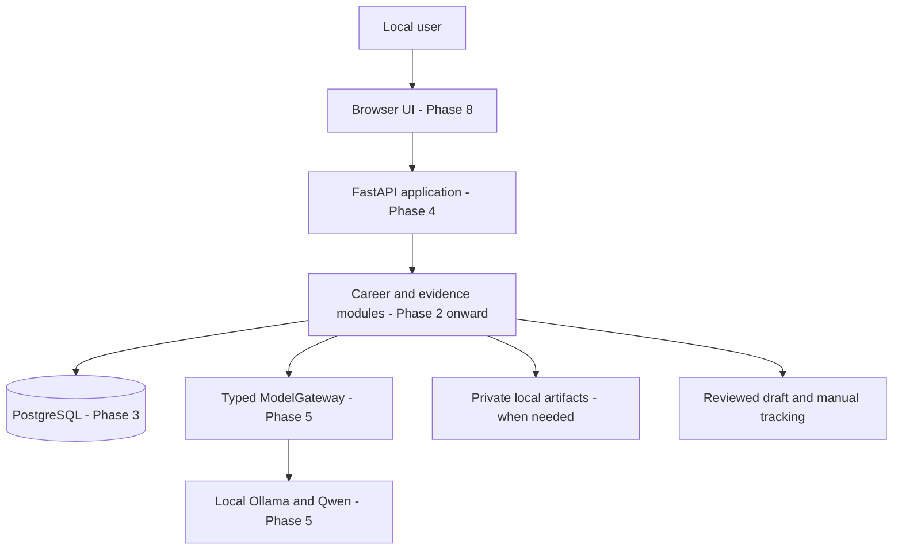

# Architecture v0.1

Status: design, not deployed software. Related decisions: [ADR register](../adr/0001-phase-0-decisions.md).

## Local topology and boundaries



Everything shown runs on the owner's computer for v0.1. This diagram describes successive additions; none exists in Phase 0. The user submits externally outside this topology.

The browser reaches loopback-bound application ports. Containers communicate through their private Compose network/service names, rather than each container's localhost. PostgreSQL has no published port by default. The browser never talks directly to the database or model service.

Docker documents that published ports default to exposure beyond the host; explicitly binding a host loopback address is required for the intended local interface. Verify the installed engine/network behavior when implementing, including the older-engine caveat, rather than treating a diagram as proof. [Docker port publishing](https://docs.docker.com/engine/network/port-publishing/)

## Module ownership

| Module or boundary | Owns | Must not own |
| --- | --- | --- |
| Career | Jobs, requirement review, CV selection, draft revisions, application states | Model transport, credentials, general orchestration |
| Evidence/profile | Assertions, support links, provenance, reviewer/method/status | Automatic certification or authorization |
| Intelligence | Requests for extraction/suggestions and typed result validation | Permission decisions or external effects |
| ModelGateway adapter | Provider calls, response parsing, size/time limits and errors | Domain persistence or direct tool execution |
| Persistence | Transactions, constraints, workspace scoping and storage adapters | Claiming data is objectively true |
| API | Authenticated application operations, request validation and limits | Trusting client-provided owner/authority |
| UI | Evidence inspection, corrections, review and status entry | Final authorization decisions |
| Future execution boundary | Authorization, exact approvals, effect audit and controlled adapters | Arbitrary generated-code execution |

Use a modular Python monolith: related modules in one application, clear responsibilities and ordinary calls. Modules do not imply separate processes or separately published packages. The frontend is a client, not an autonomous controller. Contracts start in Python; generate an API contract for TypeScript when the UI exists instead of maintaining independent handwritten schemas.

Career/profile state is authoritative relational state. Work Events record semantic facts for history and later measurement; ACTUAL is not initially an event-sourced application. Append history and state updates atomically when both are needed.

## Technology decisions and reasons

| Technology | Concrete problem | Introduce when |
| --- | --- | --- |
| Python, pytest | Domain logic and executable checks for the synthetic world | Phase 1 |
| Pydantic | Reject malformed typed boundary data | Phase 2 |
| PostgreSQL | Durable related records, constraints and transactions | Phase 3 |
| SQLAlchemy 2, Alembic | Persistence mapping and reviewable schema evolution | Phase 3 |
| FastAPI | Typed HTTP access to current operations | Phase 4 |
| Ollama/Qwen | Local semantic extraction without a paid runtime dependency | Phase 5 |
| Next.js/React/TypeScript | Inspectable career interface | Phase 8 |
| Docker Compose | Reproducible local multi-service setup | Phase 3 onward, as needed |
| Ruff/mypy | Static checks as Python code/config appear | Phase 1-2 |
| Structured logs, later OpenTelemetry | Diagnose real flows without collecting private payloads | API/model introduction; traces as useful |

Check current stable compatible versions at implementation time, then lock actual versions. No dependency is installed in Phase 0. TanStack tools, table/graph libraries and frontend component choices are deferred to the screen requirements. React Flow has no demonstrated need in the first release.

## Growth and implementation order

Phase 1 is a small offline CareerLab package and its tests. Phase 2 introduces only used domain contracts. Phase 3 adds persistence; Phase 4 the API; Phase 5 local inference; Phases 6-9 complete the useful career slice. Preserve this order rather than generating an application scaffold now.

A separate worker is deferred until durable waits/background jobs require one. When the runtime arrives, define transactional state transitions, claim leases/fencing, bounded retries and recovery before concurrent workers. PostgreSQL documents `SKIP LOCKED` as suitable for queue-like consumers, with an inconsistent view; it is not a general correctness or exactly-once guarantee. [PostgreSQL SELECT](https://www.postgresql.org/docs/current/sql-select.html)

Generic Workflow IR/runtime, connectors and activation follow the master roadmap after the useful assistance release. Security and recovery are prerequisites of each affected feature; Phase 23/24 deepen them. A cloud control plane is an explicit later deployment decision. Replaceable interfaces help evolution but do not demonstrate enterprise isolation or scalability.

## Repository structure

Actual Phase-0 tree contains only README, contributor agreement, Git hygiene, original specifications, and the contract/decision documents. No empty product directories are created.

Planned Phase-1 additions, subject to the plan:

```text
pyproject.toml
src/actual/careerlab/    # synthetic generation and scenario packaging
tests/careerlab/        # checks for repeatability and ground-truth separation
```

Create domain modules under `src/actual/` in Phase 2 when used. Add API code there in Phase 4. Add `apps/web/` in Phase 8, a worker entry point when durable execution begins, and deployment files only with real services. Split reusable packages or services when independence becomes a demonstrated need.

## Known limits

Hardware/model speed, Windows/WSL/Docker connectivity, dependency compatibility, authentication implementation and document formats remain unmeasured. Git, Python, Docker and Node commands are present on the host, but service availability and versions have not been tested. A trusted local OS administrator can inspect/alter data and logs; this release offers no protection against a fully compromised host.
